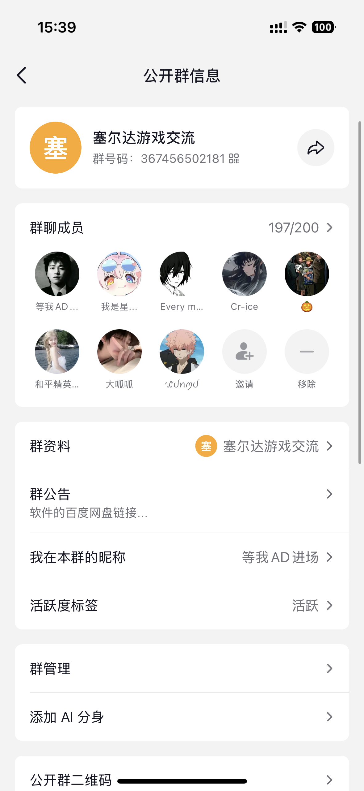
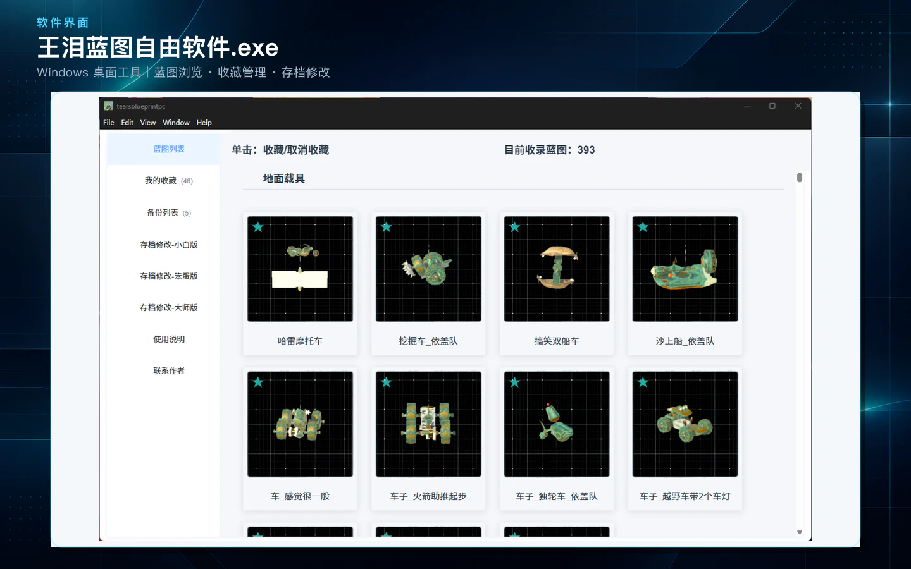
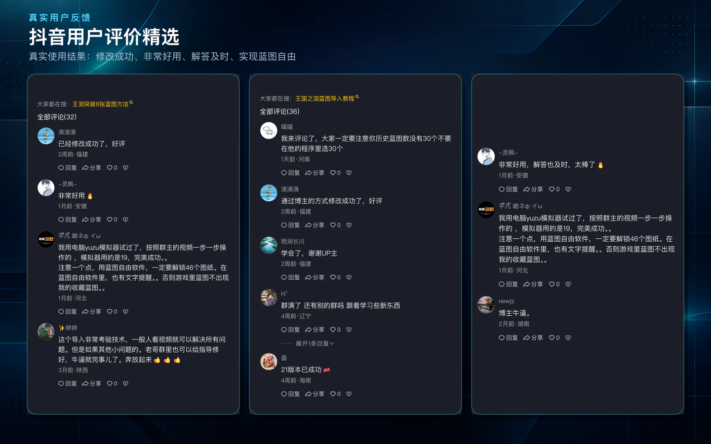
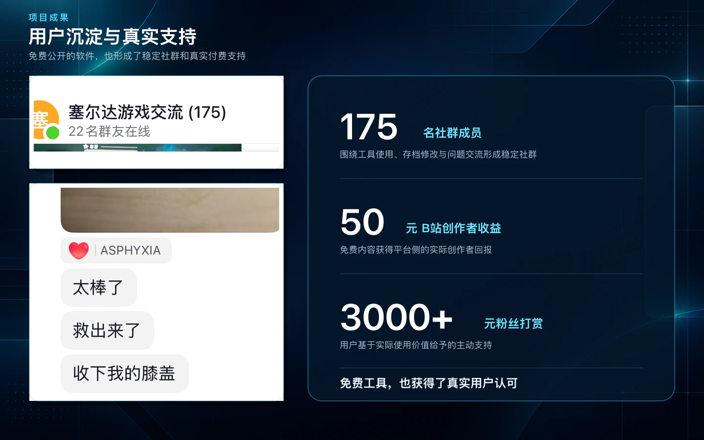

# TearsBlueprintPC · 王国之泪蓝图自由

**Atmosphere19 | System 19 and earlier · 46 + 8 blueprint workflow**

[简体中文](README.md) · [GitHub repository](https://github.com/panghuMini/TearsBlueprintPC)

## 1. What does this tool and branch do?

TearsBlueprintPC is a free desktop blueprint tool for *The Legend of Zelda: Tears of the Kingdom*. It helps players browse, organize, select and export blueprints, making MK2 builds, vehicles and other community creations more accessible to players who do not want to build every complex design by hand.

The game normally provides eight blueprint favorite slots. This project integrates community **save-editing tools** and a **Yiga blueprint mod** to offer two distinct workflows. Its save-assistance features help unlock Autobuild and the progression associated with 34 Yiga Schematics and 12 Schema Stones. Players then choose the appropriate blueprint-replacement workflow for their setup.

**This branch targets Atmosphère setups on system firmware 19 or earlier, with the 46-slot Yiga blueprint mod workflow as its main use case.** It exports selected blueprints into the mod slots corresponding to 34 Yiga Schematics and 12 Schema Stones. Together with the game’s eight favorite slots, this provides **46 + 8 = 54 custom blueprints**. It does not expand the original favorites menu itself to 54 slots. Compared with the earlier `master` branch, it also includes later save-preview, blueprint-resource and export improvements.

### Which branch should I choose?

| Branch | Purpose |
| --- | --- |
| [Atmosphere19](https://github.com/panghuMini/TearsBlueprintPC/tree/Atmosphere19) | System 19 and earlier: 46 mod slots + 8 original favorite slots |
| [Atmosphere20](https://github.com/panghuMini/TearsBlueprintPC/tree/Atmosphere20) | System 20 and newer: replace up to 30 Autobuild history entries |
| [master](https://github.com/panghuMini/TearsBlueprintPC/tree/master) | Earlier base implementation of the 46-slot mod workflow |

“19” and “20” follow the system-environment terminology used in the tutorials; they are not application version numbers. Follow the workflow for the selected branch and distinguish history entries from permanent favorite slots.

### Main capabilities across the project

- A growing, categorized collection of **nearly 400 blueprints**, including vehicles, MK2 builds and other community creations. Available resources vary by branch.
- Blueprint previews, favorites and control over export order.
- Save-editing assistance and export workflows that reduce repetitive manual file configuration.
- Ongoing user support, troubleshooting and compatibility improvements driven by player feedback.

The current player-facing release is a **Windows `.exe` desktop application**. Existing releases do not run on Windows 7, and there is no corresponding usable macOS release. **A download-free web version is a future development goal.**

The primary maintainer is **Ye Chaoyao (panghuMini / 胖虎mini版)**. My work includes desktop integration and development, organizing blueprint resources, export workflows and player support. Thanks go to the creators of the save editor, Yiga blueprint mod and blueprints, as well as the community creators who helped produce tutorials. Their contributions remain credited to their respective creators.

## 2. Video tutorials

Start with the **system 19 tutorials** below for this branch. For the 30-history-entry workflow on system 20 and newer, use `Atmosphere20`.

| Creator / platform | Workflow | Tutorial |
| --- | --- | --- |
| Collaboration with Hahappify · Bilibili | System 19 | [System 19: beyond eight favorites and one-click MK2](https://www.bilibili.com/video/BV15TyQB1EHv/) |
| Collaboration with Hahappify · Bilibili | System 20 | [System 20: MK2 and custom-build blueprint tutorial](https://www.bilibili.com/video/BV1JK1EBcEqR/) |
| Maintainer’s own tutorial · Bilibili | System 19 | [Beyond eight favorites: MK2 and blueprint selection](https://www.bilibili.com/video/BV1DX1GBeE8S/) |
| Maintainer’s own tutorial · Bilibili | System 20 | [System 20: MK2 and custom-build blueprint tutorial](https://www.bilibili.com/video/BV18NyoBpE2r/) |
| Maintainer’s own tutorial · Douyin | System 19 | [Beyond eight favorites and one-click MK2](https://v.douyin.com/KLK_OrD4nJA/) |
| Maintainer’s own tutorial · Douyin | System 20 | [System 20: MK2 and custom-build blueprint tutorial](https://v.douyin.com/XV9mihtqIow/) |

Special thanks to **Hahappify** for the collaborative tutorials and for helping the tool reach more players. The maintainer’s own tutorials are available on Bilibili and Douyin (等我AD进场). The videos are in Chinese.

## 3. Community, maintenance and the Codex for Open Source application

### A small community with a real, committed need

This tool primarily serves Zelda players, rather than other programmers. The community is modest in size, but its members have a clear need for the tool and continue to help improve it through feedback and support conversations.

In my latest statement on **October 22, 2026**, the user group had **196 members**. Based on ongoing interactions across Bilibili, Douyin and WeChat, I estimate that the tool has served **over 200 players**. That broader figure is a maintainer estimate, not deduplicated download analytics.

I provide the **application, tutorials and day-to-day help for free**. Some users have voluntarily donated as a gesture of appreciation; donations are not a condition of using the tool. We love Zelda and want more players to enjoy the creativity of the community.

### Why build a web version?

Players have reported large Windows packages and download difficulties. Some use Windows 7; others use Macs and cannot use the existing release. They have asked for a browser-based version and for continued bug fixes and useful, enjoyable new features.

The plan is to bring blueprint browsing, selection and ordering to the browser, then progressively migrate the save and blueprint file-processing workflows that can run there. Follow-up work will improve compatibility, error messages and regression coverage based on user feedback. Desktop file access and Electron-specific capabilities need to be redesigned for that environment.

### Requested support and intended use

I am preparing a [Codex for Open Source application](https://openai.com/zh-Hans-CN/form/codex-for-oss/) for this project. My main request is **ChatGPT Pro with Codex** to support web development, code improvements, debugging, testing and ongoing maintenance. Both I and this player community would be grateful for that support.

The application page lists six months of ChatGPT Pro with Codex among the benefits for selected maintainers; OpenAI determines selection. **As of this update, the application is still being prepared and reviewed. It has not been submitted, and the project has not received support through this program.** No separate API integration or API-credit usage plan is currently being promised.

### Community use and direct support

The following screenshots were provided by the maintainer. They show community participation and hands-on help with setup and blueprint files.

View the four community and support screenshots

| Group membership snapshot | In-group troubleshooting |
| --- | --- |
|  |  |
| **WeChat support: setup and follow-up call** | **WeChat support: replacing individual blueprint files** |
|  |  |

### Five images from the maintainer’s project page

These are the five images displayed for **王泪蓝图自由软件.exe** on the [maintainer’s portfolio](http://101.132.34.89:8888/#works). Copies are stored in this repository so viewing them does not depend on that server remaining online.

View all five project and feedback images

**1. Windows application overview**

**2. Public Bilibili comments**

**3. Bilibili messages and follow-up support**

**4. Douyin user feedback**

**5. Earlier community and voluntary-support snapshot**

Image source links are recorded in [docs/image-sources.json](docs/image-sources.json). Screenshots are historical snapshots: the project-page image shows 175 members, the supplied group screenshots show 197, and the maintainer’s latest stated group size is 196. These are not download or independently measured active-user counts.
